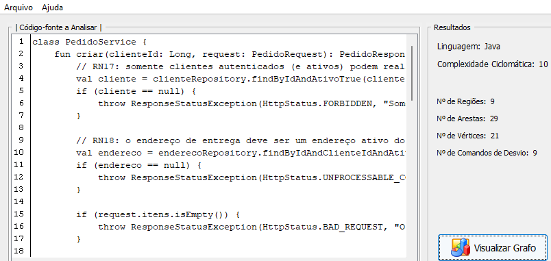
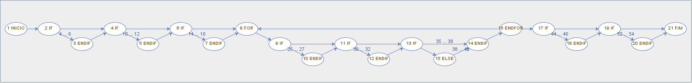
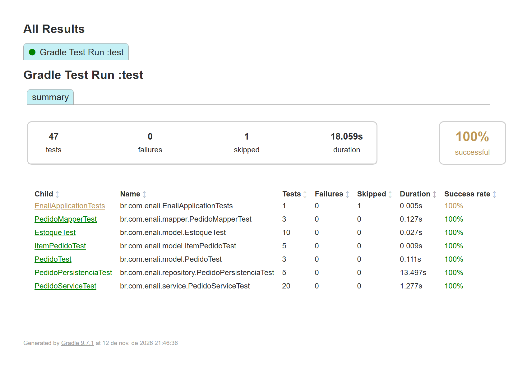
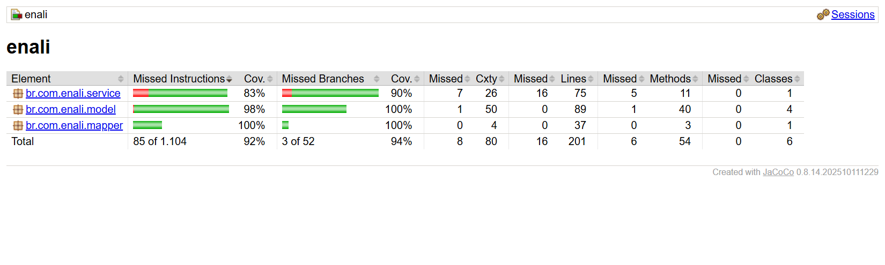
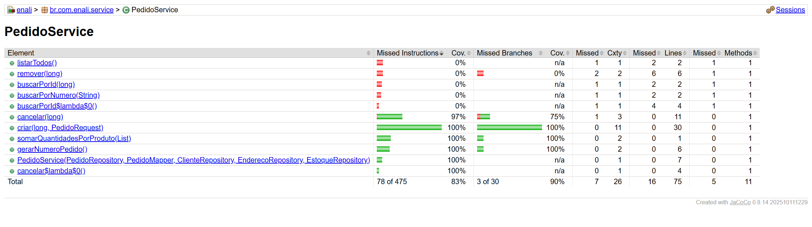
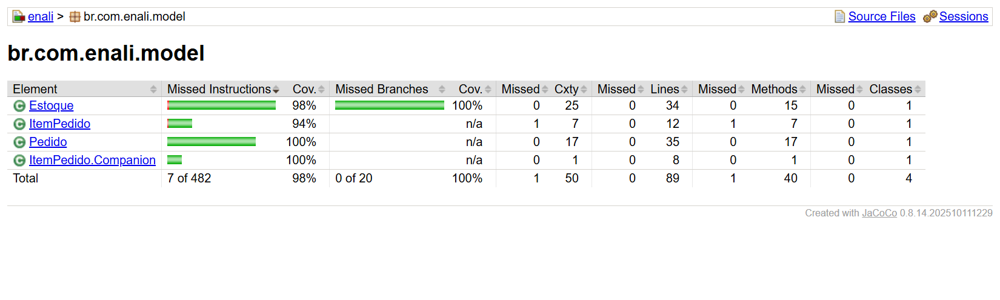
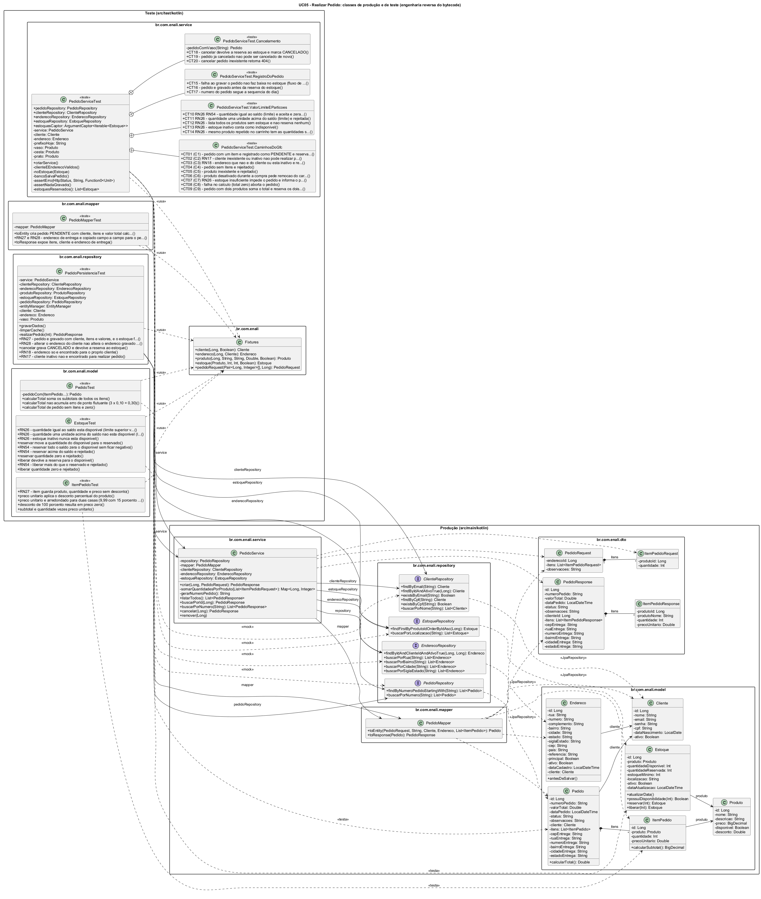

# Plano de Teste: Grupo 3 (Implementação, Testes de Unidade e Análise)

Caso de uso: **UC05 - Realizar Pedido**. Classe de aplicação: `PedidoService`. Entidades de domínio: `Pedido`, `ItemPedido`, `Estoque` (além de `Cliente`, `Endereco` e `Produto`).

Regras de negócio cobertas: RN17, RN18, RN26, RN27, RN28 e RN54.

> **Defeito encontrado antes dos testes.** Na primeira análise do código, o `POST /pedidos` recebia o `valorTotal` direto do cliente e não tinha itens, endereço nem verificação de estoque, ou seja, RN18, RN26, RN27, RN28 e RN54 não estavam implementadas. O UC05 foi completado conforme o diagrama de classes do Grupo 1 (`ItemPedido`, `Pedido.calcularTotal()`, cópia do endereço de entrega, reserva de estoque) e só então os testes abaixo foram escritos.

---

## Exercício 8: GFC do método mais complexo (ComplexGraph)

Método analisado: `PedidoService.criar(clienteId, request)` em [`src/main/kotlin/br/com/enali/service/PedidoService.kt`](../../../src/main/kotlin/br/com/enali/service/PedidoService.kt).

O ComplexGraph 1.0 não tem a opção Kotlin, então foi usada a opção **Java**. A ferramenta reconhece `if`, `else`, `for` e `while` com chaves, e essa sintaxe é igual em Kotlin. Por isso o método foi escrito com `if { }` explícitos, sem `?:`, que a ferramenta não enxergaria como desvio.

- Entrada da ferramenta: [`complexgraph/PedidoService_criar.kt`](complexgraph/PedidoService_criar.kt). No modo "abrir arquivo" o ComplexGraph espera o método dentro de uma classe; no modo "inserção manual", basta colar só o método.
- Tela da ferramenta com as métricas: [`complexgraph/tela-complexgraph.png`](complexgraph/tela-complexgraph.png)
- GFC gerado: [`complexgraph/gfc-complexgraph.png`](complexgraph/gfc-complexgraph.png)
- GFC com os nós numerados (mesmo grafo, só com os rótulos `n TIPO`): [`complexgraph/gfc-complexgraph-numerado.png`](complexgraph/gfc-complexgraph-numerado.png)




**Resultado do ComplexGraph:** 21 vértices, 29 arestas, 9 comandos de desvio, 9 regiões, complexidade ciclomática 10.

| Fórmula | Cálculo | V(G) |
|---|---|---|
| V(G) = Regiões | 9 regiões limitadas (contadas pela ferramenta) + 1 região externa | **10** |
| V(G) = E − N + 2 | 29 − 21 + 2 | **10** |
| V(G) = P + 1 | 9 nós predicados + 1 | **10** |

**Nós predicados** (as linhas são relativas ao início do método):

| Nó | Linha | Condição | Origem |
|---|---|---|---|
| 2 | 4 | `cliente == null` | RN17 |
| 4 | 10 | `endereco == null` | RN18 |
| 6 | 14 | `request.itens.isEmpty()` | Pedido sem itens |
| 9 | 25 | `estoque == null` | Produto inexistente |
| 11 | 30 | `!estoque.produto.disponivel` | Fluxo de exceção b |
| 13 | 35 | `estoque.possuiDisponibilidade(quantidade)` (if/else) | RN26 |
| 16 | 23 | `for`: há próximo produto? (o ComplexGraph decide o laço no nó ENDFOR) | Passos 3 a 8 |
| 17 | 44 | `indisponiveis.isNotEmpty()` | RN26, fluxo de exceção a |
| 19 | 52 | `pedido.valorTotal <= 0.0` | Fluxo de exceção c |

Os nós 3, 5, 7, 10, 12, 18 e 20 (rotulados "ENDIF" pela ferramenta) são os blocos `then` de cada `if`: todos lançam exceção e encerram o método. O nó 14 é o bloco que reserva o estoque e o 15 é o `else` que registra o produto indisponível. O nó 21 grava o pedido e só depois reserva o estoque (RN54).

**Caminhos independentes:**

| # | Caminho | Cenário | Caso de teste |
|---|---|---|---|
| C1 | 1-2-4-6-8-9-11-13-14-16-17-19-21 | Pedido com 1 item realizado | CT01 |
| C2 | 1-2-3 | Cliente inexistente ou inativo (RN17) | CT02 |
| C3 | 1-2-4-5 | Endereço inválido ou de outro cliente (RN18) | CT03 |
| C4 | 1-2-4-6-7 | Pedido sem itens | CT04 |
| C5 | 1-2-4-6-8-9-10 | Produto inexistente | CT05 |
| C6 | 1-2-4-6-8-9-11-12 | Produto desativado (exceção b) | CT06 |
| C7 | 1-2-4-6-8-9-11-13-15-14-16-17-18 | Estoque insuficiente (RN26, exceção a) | CT07 |
| C8 | 1-2-4-6-8-9-11-13-14-16-17-19-20 | Total zero, falha no cálculo (exceção c) | CT08 |
| C9 | 1-2-4-6-8-9-11-13-14-16-8-9-11-13-14-16-17-19-21 | Dois produtos (laço repete) | CT09 |
| C10 | 1-2-4-6-8-9-11-13-14-16-17-18 | **Inviável**: o nó 17 só é verdadeiro se algum item passou pelo nó 15 (else) | não se aplica |

---

## Exercício 9: Testes de unidade

Código dos testes: <https://github.com/RenanFaAl/enali-backend/tree/testes-unidade-pedido/src/test/kotlin/br/com/enali>

Ferramentas: **JUnit 6 (Jupiter)** e **Mockito 5**, que já vinham com o Spring Boot. O teste de integração usa **H2** em memória.

| Pacote | Classe de teste | Classe testada | Testes | Recursos |
|---|---|---|---|---|
| `service` | `PedidoServiceTest` | `PedidoService` | 20 | **Mock**: os 4 repositórios (`@Mock`). **Stub**: `given(...).willReturn(...)`. **Driver**: cada método de teste chama `service.criar(...)` no lugar do controller. O `PedidoMapper` é real. |
| `model` | `EstoqueTest` | `Estoque` | 10 | Nenhum: objeto puro, o teste é o driver |
| `model` | `ItemPedidoTest` | `ItemPedido` | 5 | Nenhum |
| `model` | `PedidoTest` | `Pedido` | 3 | Nenhum |
| `mapper` | `PedidoMapperTest` | `PedidoMapper` | 3 | Nenhum |
| `repository` | `PedidoPersistenciaTest` | `PedidoService` + repositórios | 5 | Integração de classes com repositórios **reais** sobre H2, sem mocks |
| (raiz) | `Fixtures` | n/a | n/a | Dados de teste em memória, compartilhados |

`PedidoServiceTest` é organizado em grupos (`@Nested`):

- **CaminhosDoGfc**: CT01 a CT09, um caso de teste por caminho independente (C1 a C9)
- **ValorLimiteEParticoes**: CT10 a CT14, com quantidade igual ao saldo, saldo + 1, vários produtos indisponíveis, estoque inativo e produto repetido no carrinho
- **RegistroDoPedido**: CT15 a CT17, com falha ao gravar sem baixa no estoque (exceção d), ordem de gravação e numeração sequencial
- **Cancelamento**: CT18 a CT20, com devolução da reserva, pedido já cancelado e pedido inexistente

Os testes de entidade usam **análise de valor limite**: saldo 10 com pedido de 10 (válido) e de 11 (inválido); quantidade 0; desconto de 0, 10 e 100%; arredondamento de R$ 9,99 com 15% = R$ 8,49.

---

## Exercício 10: Execução e cobertura (JaCoCo)

Comando: `./gradlew test`. Ele roda os testes e gera o relatório do JaCoCo, que ficou restrito às classes do UC05.

- Relatório de cobertura (JaCoCo): <https://raw.githack.com/RenanFaAl/enali-backend/testes-unidade-pedido/docs/plano-de-teste/grupo3/relatorios/jacoco/index.html>
- Relatório de execução (passou/falhou): <https://raw.githack.com/RenanFaAl/enali-backend/testes-unidade-pedido/docs/plano-de-teste/grupo3/relatorios/testes/index.html>
- Cópias locais: [`relatorios/jacoco/`](relatorios/jacoco/index.html) e [`relatorios/testes/`](relatorios/testes/index.html)

**Execução:** 47 testes, 46 passaram, 0 falharam e 1 foi ignorado. O ignorado é o `EnaliApplicationTests.contextLoads`, que já existia e sobe a aplicação inteira, então precisa do PostgreSQL e do `.env`.



**Cobertura por pacote e classe:**

| Pacote | Classe | Instruções | Desvios | Linhas | Métodos |
|---|---|---|---|---|---|
| service | PedidoService | 83% (397/475) | 90% (27/30) | 78% (59/75) | 6/11 |
| mapper | PedidoMapper | 100% (147/147) | 100% (2/2) | 100% (37/37) | 3/3 |
| model | Pedido | 100% (179/179) | n/a | 100% (35/35) | 17/17 |
| model | ItemPedido | 94% (49/52) | n/a | 100% (12/12) | 6/7 |
| model | ItemPedido.Companion | 100% (31/31) | n/a | 100% (8/8) | 1/1 |
| model | Estoque | 98% (216/220) | 100% (20/20) | 100% (34/34) | 15/15 |
| **Total** | | **92% (1019/1104)** | **94% (49/52)** | **92% (185/201)** | **48/54** |

Métodos de `PedidoService` efetivamente testados: `criar` (100% de instruções e de desvios), `somarQuantidadesPorProduto`, `gerarNumeroPedido` e `cancelar` (97%; falta o ramo em que o estoque do produto foi apagado). Não testados, porque ficam fora do UC05: `listarTodos`, `buscarPorId`, `buscarPorNumero` e `remover`.





---

## Exercício 11: Diagrama de classes por engenharia reversa (PlantUML)

O diagrama foi gerado a partir do **bytecode compilado** (`build/classes`, produção e teste), com o `javap` do JDK, pelo script [`diagrama/gerar_diagrama.py`](diagrama/gerar_diagrama.py). O resultado foi renderizado com o **PlantUML 1.2026.10**.

```
./gradlew test
python docs/plano-de-teste/grupo3/diagrama/gerar_diagrama.py
java -jar plantuml.jar -charset UTF-8 docs/plano-de-teste/grupo3/diagrama/diagrama-classes.puml
```

Arquivos: [`diagrama-classes.png`](diagrama/diagrama-classes.png), [`diagrama-classes.svg`](diagrama/diagrama-classes.svg) (com zoom) e [`diagrama-classes.puml`](diagrama/diagrama-classes.puml).

Relacionamentos mostrados: associação pelos campos, composição `Pedido 1 ◆ * ItemPedido`, dependências pelas assinaturas, `<<JpaRepository>>`, `<<mock>>` (campos `@Mock` lidos do bytecode), `<<testa>>` (classe sob teste), `<<usa>>` (Fixtures) e classes aninhadas (`@Nested`).


